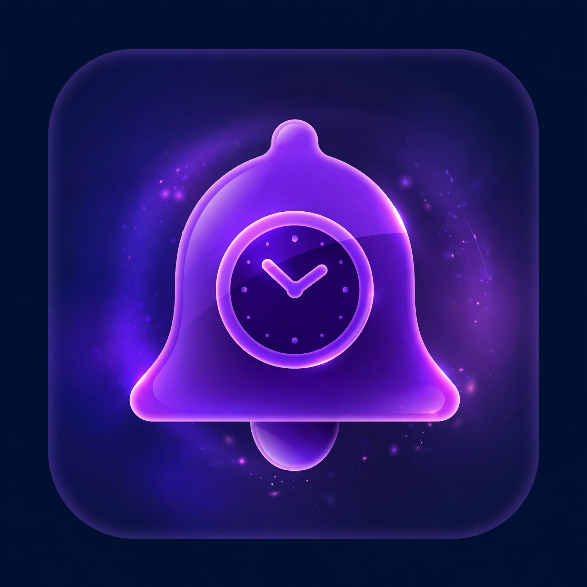

# ⏰ Duezy

<p align="center">
  
</p>

<p align="center"><i>Smart reminders for subscriptions, loan EMIs, warranties and expiries.</i></p>

## Features

- 📝 Add reminders: title, category, amount (₹), due date, notes
- 🏷️ Categories: Subscription, Loan EMI, Warranty, Document, Other
- 🔁 Repeats: one-time, monthly, quarterly, yearly — marking paid auto-creates the next occurrence
- 🔔 Local notifications (9 AM, 1/3/7 days before or on the day) — works offline, no server
- 📊 Month summary: total ₹ due + overdue count
- 🗂️ Filter by category, done-history with restore
- 🌙 Material 3 light + dark themes

## Project structure

```
lib/
  main.dart
  models/
    reminder.dart            # Reminder model (Hive map, no codegen)
  services/
    storage_service.dart     # Hive box CRUD + repeat rollover
    notification_service.dart# flutter_local_notifications scheduling
  screens/
    home_screen.dart         # summary + grouped list + history
    edit_reminder_screen.dart# add/edit form
  widgets/
    reminder_card.dart       # due row with swipe-to-delete
```

## Setup

Full project — `android/`, `ios/`, launcher icons included. Just:

```bash
cd duezy
flutter pub get
flutter run
```

### App icon

The logo lives at `assets/icon/app_icon.png`. Generate all platform icons with:

```bash
dart run flutter_launcher_icons
```

### Android — `android/app/src/main/AndroidManifest.xml`

```xml
<uses-permission android:name="android.permission.POST_NOTIFICATIONS" />
<uses-permission android:name="android.permission.SCHEDULE_EXACT_ALARM" />
<uses-permission android:name="android.permission.RECEIVE_BOOT_COMPLETED" />
```

> Exact alarms need user grant on Android 12+; the app uses inexact scheduling so it works without it, just less precise.

### iOS — `ios/Runner/Info.plist`

```xml
<key>UIBackgroundModes</key>
<array><string>remote-notification</string></array>
```

Local notification permission is requested at runtime on first launch.

## Roadmap

- [ ] Boot-completed rescheduling on Android (re-schedule after reboot)
- [ ] Home-screen widget with next 3 dues
- [ ] CSV export of history
- [ ] Biometric app lock
- [ ] Cloud backup (optional)
